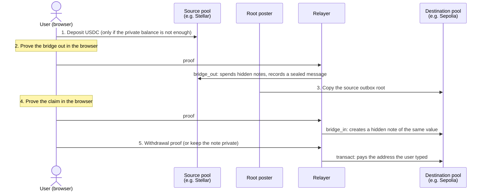
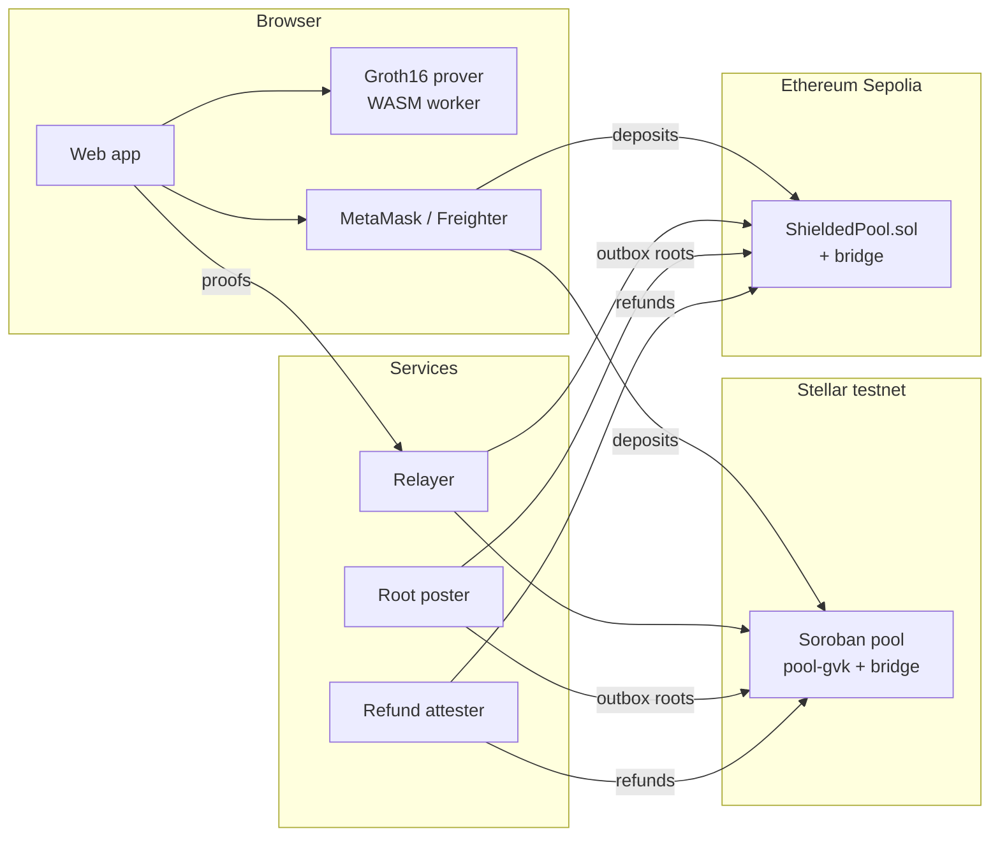

# ZKross

**A private USDC bridge between Stellar and Ethereum, with built-in auditability.**

ZKross moves USDC between Stellar and Ethereum without publicly linking the
two sides: nobody watching the chains can tell which deposit on one chain
became which withdrawal on the other, or how much a user holds. Zero-knowledge
proofs, generated in the user's browser, replace that public trail. At the
same time, every private note is encrypted to an auditor key, so a designated
authority can still trace all funds.

Built during **HackMeridian** on top of
[Stellar Private Payments](https://github.com/NethermindEth/stellar-private-payments)
(SPP), Nethermind's shielded pool for Stellar, and inspired by
[ProofBridge](https://docs.pfbridge.xyz).

> **Testnet only.** ZKross runs on Stellar testnet and Ethereum Sepolia with
> Circle's testnet USDC. It is a hackathon prototype: unaudited, with trusted
> testnet services. Never use it with real funds or mainnet keys.

---

## Contents

- [Why ZKross](#why-zkross)
- [Use cases](#use-cases)
- [How it works](#how-it-works)
- [Using the app](#using-the-app)
- [Privacy model](#privacy-model)
- [Architecture](#architecture)
- [Deployed contracts](#deployed-contracts)
- [Getting started](#getting-started)
- [Deploying for free](#deploying-for-free)
- [Testing](#testing)
- [Repository layout](#repository-layout)
- [Team and acknowledgements](#team-and-acknowledgements)
- [License](#license)

---

## Why ZKross

Public blockchains make every transfer traceable forever. Moving USDC from a
Stellar account to an Ethereum account usually ties the two addresses
together for anyone to see: amounts, timing, counterparties and balances.
That makes them hard to use for salaries, supplier payments or treasury moves.

Fully anonymous systems solve this by hiding everything, which makes them
unusable for regulated actors. ZKross takes a middle path:

| | Public bridge | Anonymous mixer | **ZKross** |
| --- | --- | --- | --- |
| The public sees the link between both sides | Yes | No | **No** |
| The public sees balances and internal transfers | Yes | No | **No** |
| An auditor can trace every transfer | Yes (so can everyone) | No | **Yes, only the auditor** |

## Use cases

- **Cross-chain treasury moves.** A company moves USDC from its Stellar
  operations to its Ethereum operations without exposing its positions,
  suppliers or timing to competitors.
- **Payments from a private balance.** Hold USDC privately on either chain and
  pay any public address later, for any amount, without revealing where the
  money came from.
- **Unlinkable personal accounts.** Use separate Stellar and Ethereum addresses
  without anyone being able to connect them through a bridge.
- **Compliant privacy.** Institutions get confidentiality towards the public
  while an auditor or regulator holding the view key keeps full visibility,
  including which bridge-out became which claim.

## How it works

### The idea in one paragraph

Each chain has a **private pool** that holds USDC. When you deposit, your
USDC becomes a **note**: a sealed envelope that only you can open, recorded
on-chain as an unreadable fingerprint. To bridge, your browser proves "I own
an envelope worth this much" without saying which one, and writes a sealed
**bridge message** on the source chain. A service copies a fingerprint of all
messages to the other chain, where a second proof claims a new envelope of the
same value, again without saying which message it comes from. The
destination pool pays out of the liquidity it already holds, so no tokens
are minted or wrapped.

### A transfer, step by step



1. **Deposit** (optional). Public USDC enters the source pool and becomes a
   private note. Skipped if your private balance already covers the amount.
2. **Bridge out.** A zero-knowledge proof spends your notes and records a
   bridge message `C` in the pool's outbox. The amount and the recipient are
   hidden inside `C`.
3. **Root posting.** The root poster copies the outbox's Merkle root to the
   other chain. About a minute from Stellar, about 15 minutes from Sepolia
   (it waits for Sepolia finality).
4. **Claim.** A second proof shows that `C` is under the posted root and
   creates a new note of the same value on the destination. A claim
   nullifier prevents double claims without revealing which `C` was claimed.
5. **Withdraw or keep.** Either the relayer pays the public address you
   typed, or the note stays in your private balance for later.

If a message is not claimed before its deadline (2 to 48 hours), it is
**refunded** to the sender as a note on the source chain. Funds are never
stuck.

### Key concepts

| Concept | In short |
| --- | --- |
| **Note** | A private piece of value (amount + owner + random blinding), stored on-chain only as a commitment. Your private balance is the sum of your notes. |
| **Identity wallet** | The one wallet (MetaMask or Freighter) you choose once. It signs a message that derives your private note key, the same key on both chains and in both directions. No key is ever stored. |
| **Relayer** | A service that submits your bridge outs, claims and withdrawals from its own account, so your wallets do not appear on-chain. It cannot change a destination or an amount: the proof would no longer verify. |
| **Root poster** | A service that copies each chain's outbox root to the other chain, so claims can be proven. It can delay claims but cannot move funds. |
| **Liquidity** | Each pool holds USDC seeded by the operator. Incoming claims are paid from it, and bridged-out value stays on the source pool as liquidity. |
| **Global View Key** | The auditor's key. Every circuit encrypts every note to it, inside the proof, so the auditor can decrypt all amounts and owners and link each bridge out to its claim. |
| **Note merging** | A proof spends at most two notes. When an amount needs more, the app first merges notes two by two, through the relayer, then pays in one transaction. |

## Using the app

You need **MetaMask** on Sepolia and/or **Freighter** on Stellar testnet, and
some testnet USDC from [Circle's faucet](https://faucet.circle.com) (20 USDC
every 2 hours per address and chain). Stellar accounts need a USDC trustline.

| Page | What it is for |
| --- | --- |
| **Bridge** | Move USDC between chains. Pick the direction and amount, then choose where it goes: **Send to an address** (the relayer pays it) or **Keep in my private balance**. |
| **Balance** | Your private balance on each chain. **Deposit** public USDC into it, or **withdraw** any amount to any address at any time, through the relayer. |
| **Liquidity** | Each pool's public reserves that back claims. The operator adds liquidity here. |
| **Activity** | Your transfers, stored in this browser, with explorer links. Unfinished transfers resume here. Export a backup of your notes. |
| **Privacy** | What is hidden and what stays public. |
| **Compliance** | How the auditor's Global View Key works. |
| **Admin** | Every pool transaction on both chains, as the public sees it and, with the view key, as the auditor sees it. |

**A first transfer**

1. Connect a wallet and make it your identity (one signature, no transaction).
2. Open **Bridge**, choose Stellar → Sepolia (or the reverse) and an amount.
3. Choose **Send to an address** and type a fresh Sepolia address, or keep the
   USDC private.
4. Confirm the deposit in your wallet if one is needed. Everything else is
   proven in your browser (10 to 30 s per proof) and sent by the relayer.

> Your notes live in this browser's storage. Clearing site data loses access
> to unspent notes: export a backup from **Activity**.

## Privacy model

**Hidden from the public**

- Which deposit or bridge out is linked to which claim or withdrawal
- Amounts inside the pools: bridged amounts, private balances, merges
- Who owns which note
- Your wallets for every step except deposits (the relayer sends the rest)

**Still public**

- Deposits and withdrawals, with their addresses and amounts (tokens enter
  and leave publicly)
- Timing: a deposit followed shortly by a withdrawal of the same amount is
  easy to match. Keep funds private for a while and vary amounts; the
  Balance page exists for that.
- The small number of users on a testnet pool

**Trust assumptions (testnet)**

- An operator-run root poster and refund attester, and a single relayer. They
  can stall the system but cannot steal funds or forge proofs.
- A single auditor key (Global View Key) that can decrypt everything.
- A single-party trusted setup for the Groth16 keys.

## Architecture



| Layer | Technology |
| --- | --- |
| Circuits | Circom, Groth16 on BN254, Poseidon2. SPP's `policy_tx_2_2_gvk_T` (2 notes in, 2 out, traceable view key) plus our `bridge_out` and `bridge_in` |
| Stellar contracts | Soroban (Rust): SPP's `pool-gvk` extended with the bridge, the outbox tree, refunds and liquidity |
| Ethereum contracts | Solidity (Foundry): `ShieldedPool`, a function-for-function port of SPP's pool plus the same bridge, with snarkjs-exported verifiers and a Poseidon2 that matches SPP's |
| Prover | Rust (`zkross-prover`) on SPP's SDK, compiled to WebAssembly for the browser |
| Services | TypeScript: relayer, root poster, refund attester |
| Web app | React, TypeScript, Vite, Tailwind |

The same circuits and proving keys are used on both chains. The design is
in [`PLAN.md`](PLAN.md) and every format (bridge message, nullifiers,
decimals, deadlines, encodings) is specified in [`SPEC.md`](SPEC.md).

**Decimals.** USDC has 7 decimals on Stellar and 6 on Ethereum. Bridge
messages carry 6-decimal amounts, so every bridged amount exists on both
chains; a leftover seventh digit stays in the sender's change note and is
never rounded away.

## Deployed contracts

| | Stellar testnet | Ethereum Sepolia |
| --- | --- | --- |
| Pool | [`CBVC37MF…GKRS`](https://stellar.expert/explorer/testnet/contract/CBVC37MFGWDBTLAEGTEYPTTQDUO7KDVDD5RHWZVYN6BYOY3RTDLBGKRS) | [`0xD8fb…36F6`](https://sepolia.etherscan.io/address/0xD8fbbCEeeeFb17a6970Eb7e920efb57fFDEe36F6) |
| USDC | Circle `USDC:GBBD47IF…LFLA5` (SAC `CBIELTK6…DAMA`) | Circle [`0x1c7D…7238`](https://sepolia.etherscan.io/address/0x1c7D4B196Cb0C7B01d743Fbc6116a902379C7238) |

Every address, including the verifiers, is in [`deployments.json`](deployments.json).

## Getting started

### Prerequisites

Node.js 20+, and to build or deploy: Rust 1.97.1 (`wasm32-unknown-unknown`),
`wasm-bindgen-cli` 0.2.128, Foundry, the Stellar CLI and Circom. Exact versions
are in [`VERSIONS.md`](VERSIONS.md). Linux, macOS or WSL2.

Testnet keys for the services come from `scripts/testnet/create-accounts.sh`
and live in the git-ignored `.env` at the repo root.

### Run everything

```sh
npm install
npm start                    # bridge service (relayer + root poster) and the site
npm start -- --site-only     # only the site
npm start -- --service-only  # only the service
```

The site opens on <http://127.0.0.1:5173> and the relayer listens on
<http://127.0.0.1:8788>. `scripts/dev.sh` first checks what is missing
(`.env`, the browser prover files, a busy port) and says
how to fix it. Ctrl+C stops everything.

The browser prover and circuit files must be staged once in
`apps/frontend/public/zk`: `bash scripts/build/stage-zk.sh` (or
`scripts/build/sync-frontend.sh` for the WSL build mirror). Without them the
site loads but cannot generate proofs. The refund attester runs separately:
`npm run refund-attester` in `services/bridge`.

### Windows (WSL2)

The scripts and the build chain (Rust, circuits, Foundry, Stellar CLI) target
Linux and macOS, so on Windows use **WSL2** (Ubuntu). Inside WSL, the steps
are the same as on Linux:

```sh
npm install
bash scripts/build/stage-zk.sh   # once: browser prover and circuit files
npm start
```

- Clone the repo inside the WSL file system (for example `~/zkross`), not
  under `C:\` or OneDrive (`/mnt/c/...`): builds there are very slow and
  OneDrive would sync the generated files. If the repo has to stay on the
  Windows side, `scripts/build/sync-frontend.sh` and `sync-spp.sh` build in a
  WSL-native mirror (`~/zkross-build`) instead.
- Open the site in your Windows browser at <http://127.0.0.1:5173>: WSL2
  forwards `localhost`, so MetaMask and Freighter work as usual.
- Native Windows (PowerShell) is not supported.

### Services in detail

- **Relayer** (`POST /relay`, `GET /status/:hash`, `GET /health`). Relays only
  withdrawals, private transfers, bridge outs and claims to the two ZKross
  pools, never deposits. Simulates first, caps gas and fees, rate-limits per
  IP and answers only the site's origins. Fee: 0 on testnet. Settings:
  `ZKROSS_RELAYER_PORT`, `ZKROSS_RELAYER_HOST`, `ZKROSS_RELAYER_ORIGINS`,
  `ZKROSS_RELAYER_MAX_GAS`, `ZKROSS_RELAYER_MAX_FEE`, `ZKROSS_RELAYER_RATE`.
- **Root poster.** Copies each outbox root to the other chain, reading Sepolia
  at the finalized block. No claim can happen while it is stopped.
- **Refund attester.** Settles messages that were not claimed, one hour after
  their deadline.

### Building the site for hosting

```sh
cd apps/frontend && npm run build   # static site in dist/ (about 55 MB with zk/)
```

`dist/` is a plain static site. Serve `.wasm` as `application/wasm`; for a
sub-path, build with `npm run build -- --base=/path/`.

### Deploying the pools

`scripts/testnet/deploy-stellar.sh` and `scripts/testnet/deploy-sepolia.sh`
deploy the pools and update `deployments.json`.

## Deploying for free

The contracts already run on the testnets. Two parts need hosting: the
**site** (static files) and the **bridge service** (a process that runs
continuously, holds testnet keys and serves the relayer over HTTPS). Both fit
in free plans; check each provider's current terms, as free tiers change.

| Part | Where (free) | Why |
| --- | --- | --- |
| Site | [Cloudflare Pages](https://pages.cloudflare.com) | Static hosting, unlimited bandwidth, files up to 25 MiB (ours: 14 MB max), serves `.wasm` correctly |
| Bridge service | [Oracle Cloud Always Free](https://www.oracle.com/cloud/free/) VM | A real Linux VM with no time limit |
| | or an [AWS](https://aws.amazon.com/free/) / Google Cloud free-tier VM | Fine for the hackathon; AWS's free offer for new accounts is time-limited credits |
| | or your own machine | Fine for a live demo, as long as it stays on |

Hosts that put free services to sleep do not work for the bridge service:
while it sleeps, no root is posted and transfers wait.

**1. The bridge service, on an Ubuntu VM** (22.04 or 24.04, x86_64 or arm64)

```sh
git clone https://github.com/enzoblain/ZKross.git && cd ZKross && git checkout dev
# from your machine: scp .env <vm>:ZKross/.env
bash scripts/deploy/server-setup.sh https://zkross.pages.dev
```

It installs Node.js, the Stellar CLI and Caddy, imports the service's
Stellar identities from `.env`, starts the service under systemd (restarted
on failure and at boot), and serves the relayer over HTTPS at
`https://<public IP>.sslip.io` (no domain needed; pass your own domain as a
second argument). Open ports 80 and 443 in the cloud firewall (Oracle: the
VCN security list; AWS: the security group). The server needs only the
service's keys: the pool admin's Stellar key never has to be on it. Logs:
`journalctl -u zkross-bridge -f`.

**2. The site, on Cloudflare Pages** (from your machine)

```sh
VITE_RELAYER_URL=https://<public IP>.sslip.io bash scripts/deploy/site.sh
```

It stages the prover if needed, builds the site with the relayer's address,
and uploads it with Cloudflare's `wrangler` (it asks you to log in the first
time and creates the `zkross` project). If the site's final address differs
from the one given to `server-setup.sh`, update `ZKROSS_RELAYER_ORIGINS` in the
server's `.env` and run `sudo systemctl restart zkross-bridge`.

## Testing

```sh
cd apps/frontend && npm test                          # web app: flows with fake pools and prover
cd contracts/ethereum && forge test                   # Ethereum pool and bridge
cd spp && cargo test -p pool-gvk                      # Stellar pool and bridge
cd spp && cargo test -p circuits --release prove_bridge  # bridge circuits with real proofs
cd services/bridge && npm test                        # relayer (needs the .env keys)
```

**End to end on the live testnets** (the bridge service must be running):

```sh
ZKROSS_REPO=$PWD npx tsx scripts/e2e/testnet.ts             # 2 transfers each way, then the auditor's view
ZKROSS_REPO=$PWD npx tsx scripts/e2e/testnet.ts --relayer   # 1 USDC each way through the relayer
```

The script deposits, bridges, waits for the root, claims and withdraws to a
fresh address in both directions, prints every transaction link, then
decrypts every note with the view key and links each bridge out to its claim.
With `--relayer`, it also checks on-chain that the relayer, never a user,
sent each transaction. It resumes where it stopped.

## Repository layout

```
apps/frontend/        Web app (React + Vite)
contracts/ethereum/   Foundry project: ShieldedPool, verifiers, Poseidon2, Merkle tree
spp/                  SPP at a pinned commit, with the Stellar bridge and the bridge circuits
prover/               zkross-prover (Rust) and its WebAssembly build
services/bridge/      Relayer, root poster, refund attester
scripts/              Build, deployment, end-to-end and dev scripts
PLAN.md               Build plan and design decisions
SPEC.md               Formats, encodings and test vectors
VERSIONS.md           Pinned versions, including the SPP commit and our changes to it
deployments.json      Deployed addresses
```

An experimental Circle CCTP track is kept apart on the
[`cctp-experimental`](https://github.com/enzoblain/ZKross/tree/cctp-experimental)
branch.

## Team and acknowledgements

Built at HackMeridian by:

- **Emin** ([@EminBgA](https://github.com/EminBgA))
- **Romain** ([@Romainwerrr](https://github.com/Romainwerrr))
- **Enzo** ([@enzoblain](https://github.com/enzoblain))

Thanks to:

- [Nethermind](https://github.com/NethermindEth/stellar-private-payments) for
  Stellar Private Payments, the base of the pools, circuits and tooling
  (Apache 2.0; its circuit compiler is GPLv3 and compiled circuits are
  LGPLv3, see `spp/`)
- [ProofBridge](https://docs.pfbridge.xyz) for the bridge-message design
- [Circle](https://www.circle.com) for testnet USDC on both chains
- The [Stellar](https://stellar.org) ecosystem and its
  [privacy and ZK resources](https://github.com/stellar/ecosystem-resources/tree/main/privacy-zk)

## License

ZKross is licensed under the [Apache License 2.0](LICENSE). It includes
Stellar Private Payments under `spp/`, also Apache 2.0, some parts of which
carry other licenses; see [`NOTICE`](NOTICE).
